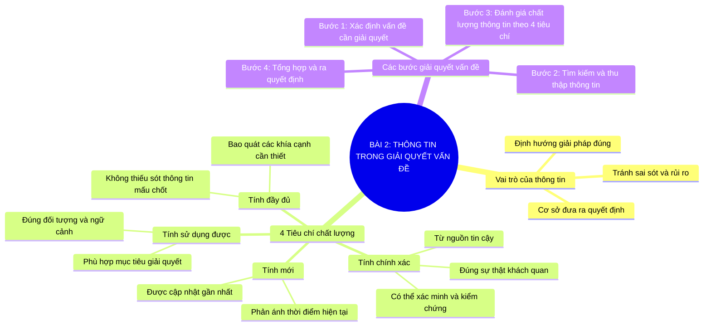

# Sơ Đồ Tư Duy - Tin Học 9: Bài 2

> **Bài 2: Thông tin trong giải quyết vấn đề**  
> *Chương trình GDPT 2018 - Bộ sách Kết nối tri thức với cuộc sống (Chủ đề 2)*

---

## 1. Sơ đồ tư duy dạng Mermaid (Mindmap trực quan)

---

## 2. Tóm tắt nhanh ghi nhớ (Flashcard dạng bảng)

| Tiêu chí | Câu hỏi kiểm tra nhanh | Ví dụ thực tế |
| :--- | :--- | :--- |
| **Tính mới** | Thông tin có còn hiệu lực, cập nhật gần đây không? | Dự báo thời tiết ngày hôm nay so với tuần trước. |
| **Tính chính xác** | Nguồn thông tin có chính thống, kiểm chứng được không? | Thông báo từ Cổng thông tin Bộ GD&ĐT so với tin đồn mạng xã hội. |
| **Tính đầy đủ** | Đã đủ dữ liệu để ra quyết định chưa? | Lịch thi đấu bóng đá có cả giờ, ngày và địa điểm sân vận động. |
| **Tính sử dụng được** | Thông tin có đúng đối tượng và mục đích của mình không? | Tìm tuyến xe buýt số 12 đi từ nhà tới trường, thông tin phải đúng lộ trình địa phương. |

---

## 3. Liên kết bài học trực tuyến
👉 [Mở bài học tương tác trực tuyến](../../lessons/lop-09/bai-02-thong-tin-trong-giai-quyet-van-de.html)
