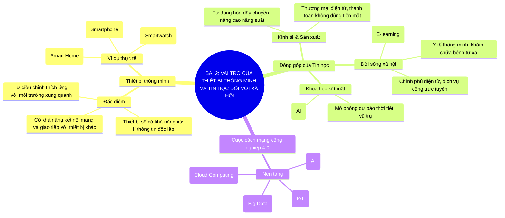

# Sơ Đồ Tư Duy - Tin Học 10: Bài 2

> **Bài 2: Vai trò của thiết bị thông minh và tin học đối với xã hội**  
> *Chương trình GDPT 2018 - Bộ sách Kết nối tri thức với cuộc sống (Chủ đề 1: Máy tính và xã hội tri thức)*

---

## 1. Sơ đồ tư duy dạng Mermaid (Trực quan hóa kiến thức)

---

## 2. Tóm tắt nhanh cốt lõi ghi nhớ (Flashcard dạng bảng)

| Khái niệm cốt lõi | Nội dung trọng tâm cần nhớ |
| :--- | :--- |
| **Thiết bị thông minh** | Có khả năng kết nối mạng, tương tác, tự động xử lí và thích ứng với môi trường. |
| **Ứng dụng tin học** | Thay đổi căn bản các lĩnh vực: kinh tế, y tế, giáo dục, chính phủ số và khoa học. |
| **Công nghiệp 4.0** | Tích hợp IoT, AI, Big Data và Điện toán đám mây vào mọi mặt đời sống. |

---

## 3. Liên kết bài học trực tuyến
👉 [Mở bài học tương tác trực tuyến](../../lessons/lop-10/bai-02.html)
