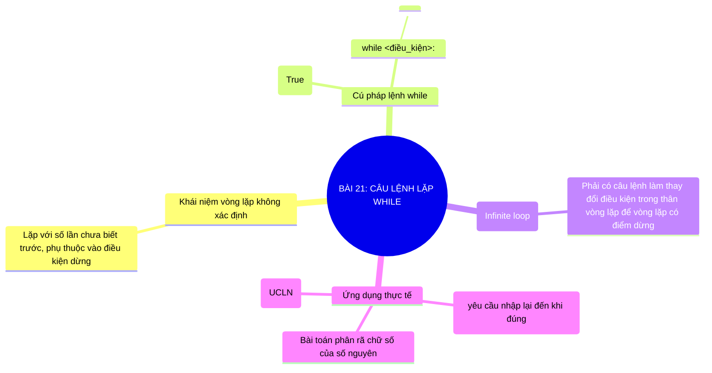

# Sơ Đồ Tư Duy - Tin Học 10: Bài 21

> **Bài 21: Câu lệnh lặp while**  
> *Chương trình GDPT 2018 - Bộ sách Kết nối tri thức với cuộc sống (Chủ đề 5: Lập trình Python)*

---

## 1. Sơ đồ tư duy dạng Mermaid (Trực quan hóa kiến thức)

---

## 2. Tóm tắt nhanh cốt lõi ghi nhớ (Flashcard dạng bảng)

| Khái niệm cốt lõi | Nội dung trọng tâm cần nhớ |
| :--- | :--- |
| **Lặp while** | Chạy lặp đi lặp lại chừng nào điều kiện còn Đúng; dừng lại ngay khi điều kiện Sai. |
| **Lỗi lặp vô tận** | Xảy ra khi điều kiện lặp luôn đúng; cần cập nhật biến điều kiện trong thân vòng lặp. |
| **Ứng dụng** | Phù hợp các bài toán lặp dựa trên điều kiện hội tụ hoặc kiểm tra dữ liệu đầu vào. |

---

## 3. Liên kết bài học trực tuyến
👉 [Mở bài học tương tác trực tuyến](../../lessons/lop-10/bai-21.html)
