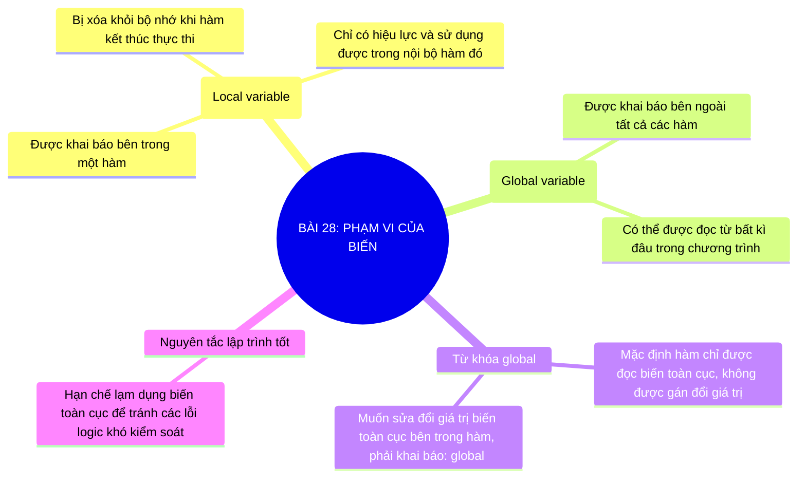

# Sơ Đồ Tư Duy - Tin Học 10: Bài 28

> **Bài 28: Phạm vi của biến**  
> *Chương trình GDPT 2018 - Bộ sách Kết nối tri thức với cuộc sống (Chủ đề 5: Lập trình Python)*

---

## 1. Sơ đồ tư duy dạng Mermaid (Trực quan hóa kiến thức)

---

## 2. Tóm tắt nhanh cốt lõi ghi nhớ (Flashcard dạng bảng)

| Khái niệm cốt lõi | Nội dung trọng tâm cần nhớ |
| :--- | :--- |
| **Biến cục bộ** | Khai báo trong hàm, chỉ sống và dùng được bên trong hàm đó. |
| **Biến toàn cục** | Khai báo ngoài hàm, có phạm vi nhìn thấy trên toàn bộ chương trình. |
| **Từ khóa global** | Bắt buộc dùng khi muốn gán lại giá trị cho biến toàn cục từ trong hàm. |

---

## 3. Liên kết bài học trực tuyến
👉 [Mở bài học tương tác trực tuyến](../../lessons/lop-10/bai-28.html)
