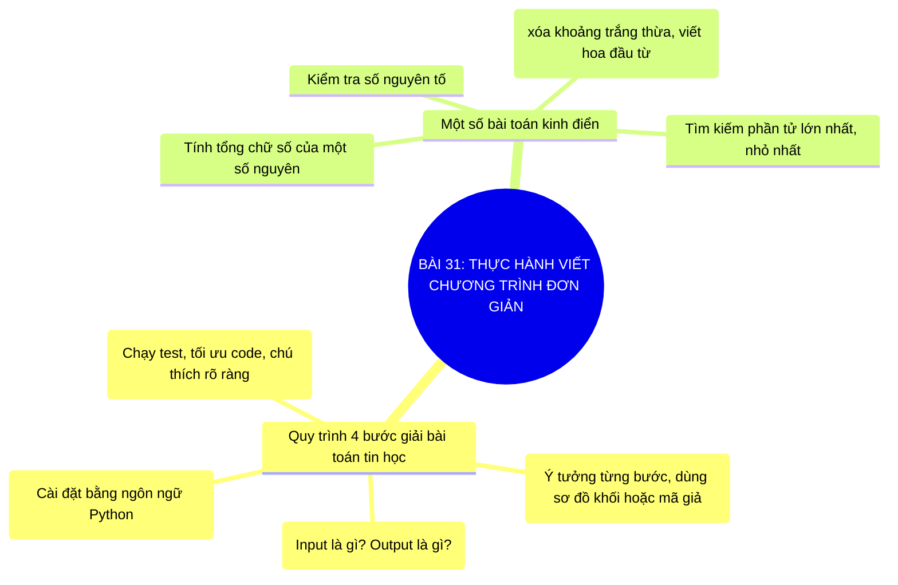

# Sơ Đồ Tư Duy - Tin Học 10: Bài 31

> **Bài 31: Thực hành viết chương trình đơn giản**  
> *Chương trình GDPT 2018 - Bộ sách Kết nối tri thức với cuộc sống (Chủ đề 5: Lập trình Python)*

---

## 1. Sơ đồ tư duy dạng Mermaid (Trực quan hóa kiến thức)

---

## 2. Tóm tắt nhanh cốt lõi ghi nhớ (Flashcard dạng bảng)

| Khái niệm cốt lõi | Nội dung trọng tâm cần nhớ |
| :--- | :--- |
| **4 Bước giải bài toán** | Xác định I/O -> Thiết kế giải thuật -> Viết mã nguồn -> Kiểm thử. |
| **Tối ưu hóa** | Chọn cấu trúc dữ liệu và giải thuật hợp lí để chương trình chạy nhanh và tốn ít bộ nhớ. |
| **Chú thích (Comment)** | Viết chú thích (#) giúp giải thích ý nghĩa mã nguồn cho người đọc. |

---

## 3. Liên kết bài học trực tuyến
👉 [Mở bài học tương tác trực tuyến](../../lessons/lop-10/bai-31.html)
