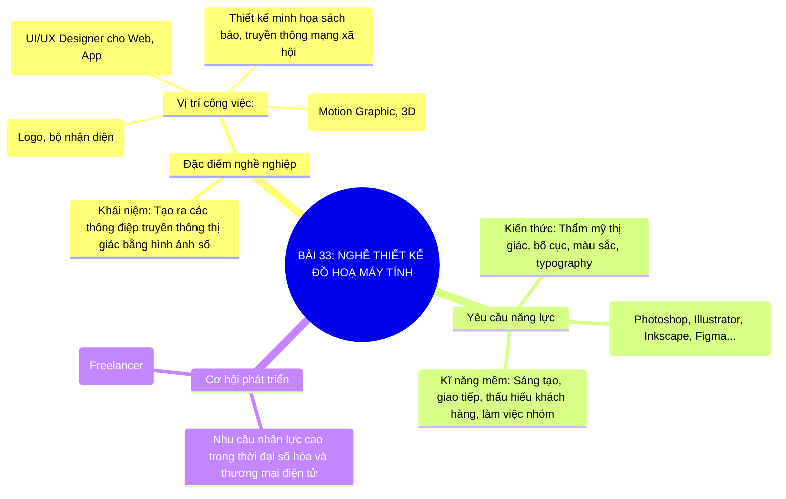

# Sơ Đồ Tư Duy - Tin Học 10: Bài 33

> **Bài 33: Nghề thiết kế đồ hoạ máy tính**  
> *Chương trình GDPT 2018 - Bộ sách Kết nối tri thức với cuộc sống (Chủ đề 6: Hướng nghiệp với tin học)*

---

## 1. Sơ đồ tư duy dạng Mermaid (Trực quan hóa kiến thức)

---

## 2. Tóm tắt nhanh cốt lõi ghi nhớ (Flashcard dạng bảng)

| Khái niệm cốt lõi | Nội dung trọng tâm cần nhớ |
| :--- | :--- |
| **Nghề Đồ họa máy tính** | Ứng dụng công nghệ tạo sản phẩm truyền thông thị giác: logo, banner, UI/UX. |
| **Yêu cầu năng lực** | Kết hợp giữa tư duy thẩm mỹ nghệ thuật và kĩ năng sử dụng thành thạo phần mềm đồ họa. |
| **Cơ hội nghề nghiệp** | Đa dạng, linh hoạt từ công ty quảng cáo đến thiết kế sản phẩm số toàn cầu. |

---

## 3. Liên kết bài học trực tuyến
👉 [Mở bài học tương tác trực tuyến](../../lessons/lop-10/bai-33.html)
