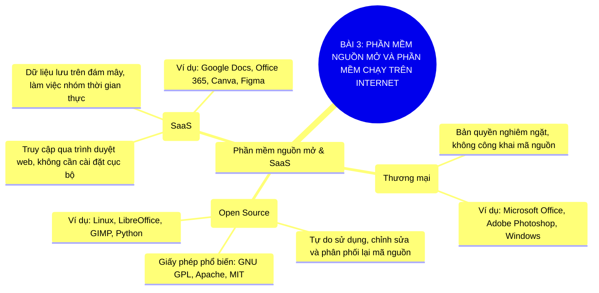

# Sơ Đồ Tư Duy - Tin Học 11: Bài 3

> **Phần mềm nguồn mở và phần mềm chạy trên Internet**  
> *Chương trình GDPT 2018 - Bộ sách Kết nối tri thức với cuộc sống (Chủ đề 1: Máy tính và xã hội tri thức)*

---

## 1. Sơ đồ tư duy dạng Mermaid (Trực quan hóa kiến thức)

---

## 2. Flashcards - Thuật ngữ & Kiến thức cốt lõi

### 🏷️ Phần mềm nguồn mở
> **Khái niệm cốt lõi:**  
> Phần mềm công khai mã nguồn cho cộng đồng tự do nghiên cứu, sửa đổi và chia sẻ.

---
### 🏷️ Giấy phép GNU GPL
> **Khái niệm cốt lõi:**  
> Bảo đảm quyền tự do sử dụng và bắt buộc các phiên bản phái sinh cũng phải mở mã nguồn.

---
### 🏷️ SaaS (Software as a Service)
> **Khái niệm cốt lõi:**  
> Mô hình cung cấp ứng dụng như một dịch vụ chạy trực tiếp trên Internet qua trình duyệt.

---

## 3. Hướng dẫn ôn tập & Tư duy tự học

1. **Quan sát tổng quan**: Đọc từ nhánh gốc ở tâm sơ đồ tư duy Mermaid ra các nhánh cấp 1 và cấp 2.
2. **Đối chiếu thực tế**: Tự liên hệ các khái niệm với thao tác thực hành trên máy tính và tình huống thực tiễn.
3. **Tự kiểm tra**: Che phần định nghĩa trong các thẻ Flashcards và tự diễn đạt lại bằng ngôn từ của mình.

---
*Tài liệu thuộc Hệ sinh thái giải pháp giáo dục VietApps (VietMix, VietTest, VietBook, VietTeach).*
