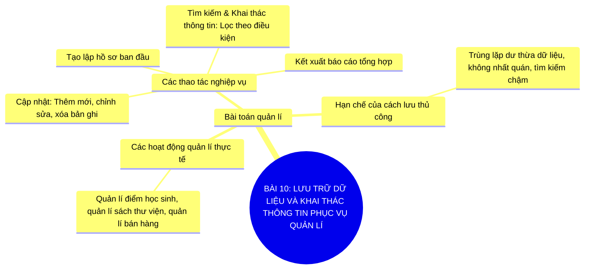

# Sơ Đồ Tư Duy - Tin Học 11: Bài 10

> **Lưu trữ dữ liệu và khai thác thông tin phục vụ quản lí**  
> *Chương trình GDPT 2018 - Bộ sách Kết nối tri thức với cuộc sống (Chủ đề 4: Giới thiệu các hệ cơ sở dữ liệu)*

---

## 1. Sơ đồ tư duy dạng Mermaid (Trực quan hóa kiến thức)

---

## 2. Flashcards - Thuật ngữ & Kiến thức cốt lõi

### 🏷️ Bài toán quản lí
> **Khái niệm cốt lõi:**  
> Bài toán thu thập, xử lí và khai thác dữ liệu để phục vụ việc ra quyết định điều hành tổ chức.

---
### 🏷️ Tính không nhất quán
> **Khái niệm cốt lõi:**  
> Tình trạng cùng một thông tin nhưng lại có giá trị khác nhau ở các nơi lưu trữ khác nhau.

---
### 🏷️ Kết xuất báo cáo
> **Khái niệm cốt lõi:**  
> Thao tác tổng hợp và trình bày dữ liệu theo định dạng chuẩn phục vụ người quản lí.

---

## 3. Hướng dẫn ôn tập & Tư duy tự học

1. **Quan sát tổng quan**: Đọc từ nhánh gốc ở tâm sơ đồ tư duy Mermaid ra các nhánh cấp 1 và cấp 2.
2. **Đối chiếu thực tế**: Tự liên hệ các khái niệm với thao tác thực hành trên máy tính và tình huống thực tiễn.
3. **Tự kiểm tra**: Che phần định nghĩa trong các thẻ Flashcards và tự diễn đạt lại bằng ngôn từ của mình.

---
*Tài liệu thuộc Hệ sinh thái giải pháp giáo dục VietApps (VietMix, VietTest, VietBook, VietTeach).*
