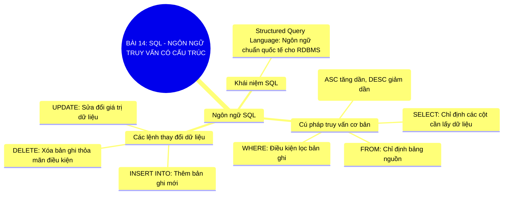

# Sơ Đồ Tư Duy - Tin Học 11: Bài 14

> **SQL - Ngôn ngữ truy vấn có cấu trúc**  
> *Chương trình GDPT 2018 - Bộ sách Kết nối tri thức với cuộc sống (Chủ đề 4: Giới thiệu các hệ cơ sở dữ liệu)*

---

## 1. Sơ đồ tư duy dạng Mermaid (Trực quan hóa kiến thức)

---

## 2. Flashcards - Thuật ngữ & Kiến thức cốt lõi

### 🏷️ SELECT - FROM - WHERE
> **Khái niệm cốt lõi:**  
> Mệnh đề cốt lõi của SQL dùng để trích xuất dữ liệu theo các điều kiện xác định.

---
### 🏷️ ORDER BY
> **Khái niệm cốt lõi:**  
> Mệnh đề SQL dùng để sắp xếp dữ liệu trả về theo thứ tự tăng dần hoặc giảm dần.

---
### 🏷️ UPDATE & DELETE
> **Khái niệm cốt lõi:**  
> Hai lệnh SQL thao tác dữ liệu cần dùng kèm mệnh đề WHERE để tránh sửa/xóa nhầm toàn bộ bảng.

---

## 3. Hướng dẫn ôn tập & Tư duy tự học

1. **Quan sát tổng quan**: Đọc từ nhánh gốc ở tâm sơ đồ tư duy Mermaid ra các nhánh cấp 1 và cấp 2.
2. **Đối chiếu thực tế**: Tự liên hệ các khái niệm với thao tác thực hành trên máy tính và tình huống thực tiễn.
3. **Tự kiểm tra**: Che phần định nghĩa trong các thẻ Flashcards và tự diễn đạt lại bằng ngôn từ của mình.

---
*Tài liệu thuộc Hệ sinh thái giải pháp giáo dục VietApps (VietMix, VietTest, VietBook, VietTeach).*
