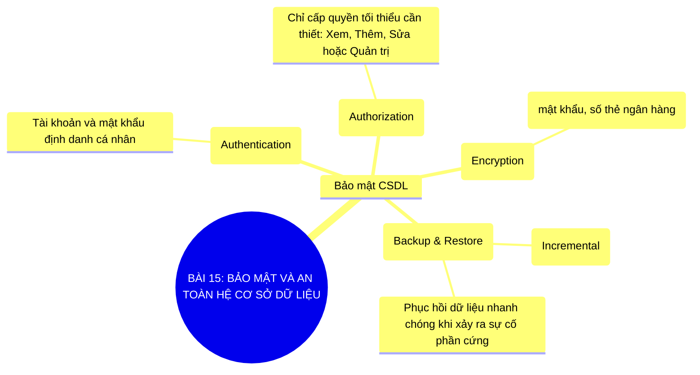

# Sơ Đồ Tư Duy - Tin Học 11: Bài 15

> **Bảo mật và an toàn hệ cơ sở dữ liệu**  
> *Chương trình GDPT 2018 - Bộ sách Kết nối tri thức với cuộc sống (Chủ đề 4: Giới thiệu các hệ cơ sở dữ liệu)*

---

## 1. Sơ đồ tư duy dạng Mermaid (Trực quan hóa kiến thức)

---

## 2. Flashcards - Thuật ngữ & Kiến thức cốt lõi

### 🏷️ Phân quyền truy cập
> **Khái niệm cốt lõi:**  
> Kiểm soát chặt chẽ người dùng nào được phép đọc hoặc chỉnh sửa những bảng dữ liệu nào.

---
### 🏷️ Sao lưu dự phòng (Backup)
> **Khái niệm cốt lõi:**  
> Tạo bản sao lưu trữ CSDL ra nơi an toàn để sẵn sàng khôi phục khi gặp thảm họa.

---
### 🏷️ Mã hóa mật khẩu
> **Khái niệm cốt lõi:**  
> Chuyển mật khẩu người dùng thành chuỗi băm (Hash) không thể đảo ngược để chống lộ lọt.

---

## 3. Hướng dẫn ôn tập & Tư duy tự học

1. **Quan sát tổng quan**: Đọc từ nhánh gốc ở tâm sơ đồ tư duy Mermaid ra các nhánh cấp 1 và cấp 2.
2. **Đối chiếu thực tế**: Tự liên hệ các khái niệm với thao tác thực hành trên máy tính và tình huống thực tiễn.
3. **Tự kiểm tra**: Che phần định nghĩa trong các thẻ Flashcards và tự diễn đạt lại bằng ngôn từ của mình.

---
*Tài liệu thuộc Hệ sinh thái giải pháp giáo dục VietApps (VietMix, VietTest, VietBook, VietTeach).*
