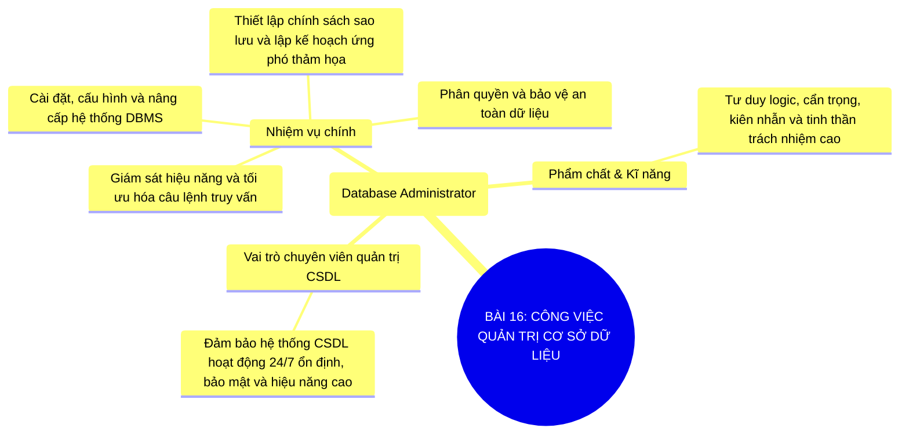

# Sơ Đồ Tư Duy - Tin Học 11: Bài 16

> **Công việc quản trị cơ sở dữ liệu**  
> *Chương trình GDPT 2018 - Bộ sách Kết nối tri thức với cuộc sống (Chủ đề 5: Hướng nghiệp với Tin học)*

---

## 1. Sơ đồ tư duy dạng Mermaid (Trực quan hóa kiến thức)

---

## 2. Flashcards - Thuật ngữ & Kiến thức cốt lõi

### 🏷️ Quản trị viên CSDL (DBA)
> **Khái niệm cốt lõi:**  
> Chuyên gia chịu trách nhiệm cao nhất về hoạt động, an toàn và hiệu năng của hệ CSDL.

---
### 🏷️ Tối ưu hóa truy vấn
> **Khái niệm cốt lõi:**  
> Kĩ thuật tinh chỉnh câu lệnh SQL và chỉ mục (Index) để hệ thống phản hồi kết quả nhanh nhất.

---
### 🏷️ Kế hoạch ứng phó sự cố
> **Khái niệm cốt lõi:**  
> Quy trình chuẩn bị sẵn sàng để phục hồi dữ liệu trong thời gian ngắn nhất khi hệ thống gặp lỗi.

---

## 3. Hướng dẫn ôn tập & Tư duy tự học

1. **Quan sát tổng quan**: Đọc từ nhánh gốc ở tâm sơ đồ tư duy Mermaid ra các nhánh cấp 1 và cấp 2.
2. **Đối chiếu thực tế**: Tự liên hệ các khái niệm với thao tác thực hành trên máy tính và tình huống thực tiễn.
3. **Tự kiểm tra**: Che phần định nghĩa trong các thẻ Flashcards và tự diễn đạt lại bằng ngôn từ của mình.

---
*Tài liệu thuộc Hệ sinh thái giải pháp giáo dục VietApps (VietMix, VietTest, VietBook, VietTeach).*
