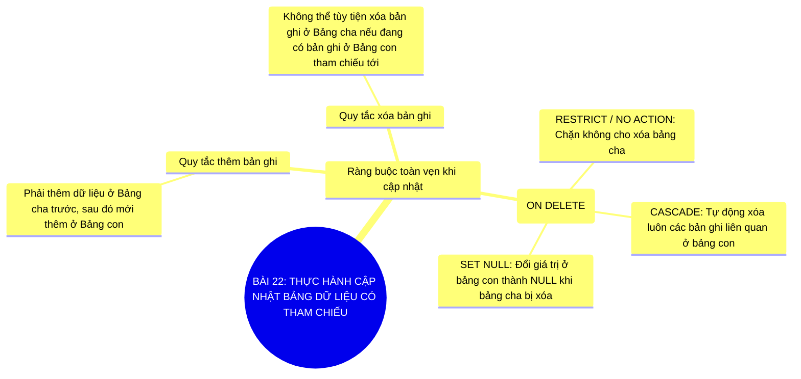

# Sơ Đồ Tư Duy - Tin Học 11: Bài 22

> **Thực hành cập nhật bảng dữ liệu có tham chiếu**  
> *Chương trình GDPT 2018 - Bộ sách Kết nối tri thức với cuộc sống (Chủ đề 6: Thực hành CSDL)*

---

## 1. Sơ đồ tư duy dạng Mermaid (Trực quan hóa kiến thức)

---

## 2. Flashcards - Thuật ngữ & Kiến thức cốt lõi

### 🏷️ CASCADE
> **Khái niệm cốt lõi:**  
> Tùy chọn tự động lan truyền thao tác xóa/sửa từ bảng cha sang toàn bộ bản ghi liên quan ở bảng con.

---
### 🏷️ Thứ tự nhập liệu
> **Khái niệm cốt lõi:**  
> Quy tắc bắt buộc: Phải có bảng cha trước thì mới có dữ liệu liên kết ở bảng con.

---
### 🏷️ RESTRICT
> **Khái niệm cốt lõi:**  
> Quy tắc an toàn ngăn chặn người dùng vô tình xóa mất bản ghi dữ liệu gốc quan trọng.

---

## 3. Hướng dẫn ôn tập & Tư duy tự học

1. **Quan sát tổng quan**: Đọc từ nhánh gốc ở tâm sơ đồ tư duy Mermaid ra các nhánh cấp 1 và cấp 2.
2. **Đối chiếu thực tế**: Tự liên hệ các khái niệm với thao tác thực hành trên máy tính và tình huống thực tiễn.
3. **Tự kiểm tra**: Che phần định nghĩa trong các thẻ Flashcards và tự diễn đạt lại bằng ngôn từ của mình.

---
*Tài liệu thuộc Hệ sinh thái giải pháp giáo dục VietApps (VietMix, VietTest, VietBook, VietTeach).*
