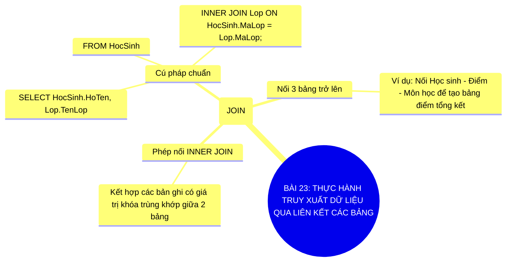

# Sơ Đồ Tư Duy - Tin Học 11: Bài 23

> **Thực hành truy xuất dữ liệu qua liên kết các bảng**  
> *Chương trình GDPT 2018 - Bộ sách Kết nối tri thức với cuộc sống (Chủ đề 6: Thực hành CSDL)*

---

## 1. Sơ đồ tư duy dạng Mermaid (Trực quan hóa kiến thức)

---

## 2. Flashcards - Thuật ngữ & Kiến thức cốt lõi

### 🏷️ INNER JOIN
> **Khái niệm cốt lõi:**  
> Phép kết nối các bảng dữ liệu dựa trên điều kiện trùng khớp giữa khóa chính và khóa ngoài.

---
### 🏷️ Tạo báo cáo tổng hợp
> **Khái niệm cốt lõi:**  
> Ứng dụng thực tế của phép JOIN để kết xuất thông tin toàn diện từ nhiều bảng riêng lẻ.

---
### 🏷️ Mệnh đề ON
> **Khái niệm cốt lõi:**  
> Chỉ định điều kiện liên kết kết nối cụ thể giữa hai trường của hai bảng trong phép JOIN.

---

## 3. Hướng dẫn ôn tập & Tư duy tự học

1. **Quan sát tổng quan**: Đọc từ nhánh gốc ở tâm sơ đồ tư duy Mermaid ra các nhánh cấp 1 và cấp 2.
2. **Đối chiếu thực tế**: Tự liên hệ các khái niệm với thao tác thực hành trên máy tính và tình huống thực tiễn.
3. **Tự kiểm tra**: Che phần định nghĩa trong các thẻ Flashcards và tự diễn đạt lại bằng ngôn từ của mình.

---
*Tài liệu thuộc Hệ sinh thái giải pháp giáo dục VietApps (VietMix, VietTest, VietBook, VietTeach).*
