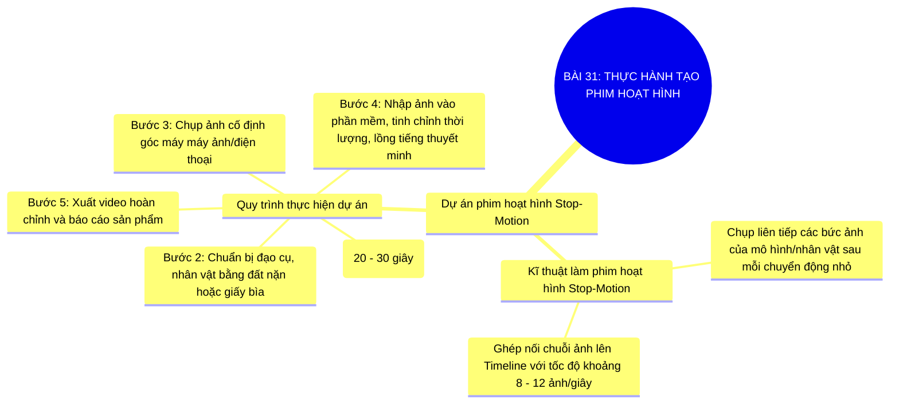

# Sơ Đồ Tư Duy - Tin Học 11: Bài 31

> **Thực hành tạo phim hoạt hình**  
> *Chương trình GDPT 2018 - Bộ sách Kết nối tri thức với cuộc sống (Chủ đề 7: Phần mềm chỉnh sửa ảnh và làm video)*

---

## 1. Sơ đồ tư duy dạng Mermaid (Trực quan hóa kiến thức)

---

## 2. Flashcards - Thuật ngữ & Kiến thức cốt lõi

### 🏷️ Kĩ thuật Stop-Motion
> **Khái niệm cốt lõi:**  
> Nghệ thuật làm phim hoạt hình bằng cách chụp ảnh chuỗi chuyển động của mô hình tĩnh.

---
### 🏷️ Kịch bản phân cảnh
> **Khái niệm cốt lõi:**  
> Bản vẽ phác thảo và mô tả chi tiết từng khung hình của câu chuyện trước khi bấm máy.

---
### 🏷️ Lồng tiếng thuyết minh
> **Khái niệm cốt lõi:**  
> Thu âm giọng nói của học sinh để thổi hồn sinh động vào các nhân vật trong bộ phim.

---

## 3. Hướng dẫn ôn tập & Tư duy tự học

1. **Quan sát tổng quan**: Đọc từ nhánh gốc ở tâm sơ đồ tư duy Mermaid ra các nhánh cấp 1 và cấp 2.
2. **Đối chiếu thực tế**: Tự liên hệ các khái niệm với thao tác thực hành trên máy tính và tình huống thực tiễn.
3. **Tự kiểm tra**: Che phần định nghĩa trong các thẻ Flashcards và tự diễn đạt lại bằng ngôn từ của mình.

---
*Tài liệu thuộc Hệ sinh thái giải pháp giáo dục VietApps (VietMix, VietTest, VietBook, VietTeach).*
